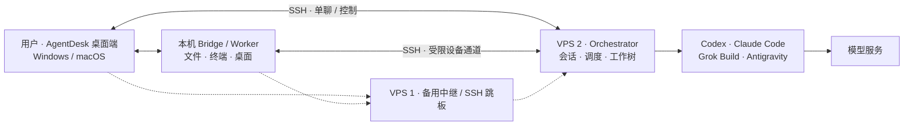

# AgentDesk

**把多个 AI 编程助手放进同一个桌面工作台，让它们在你的 Windows / macOS 电脑上完成真实开发任务。**

AgentDesk 是一个以 **本机开发、远程模型会话、多 Agent 协作** 为核心的 Electron 桌面项目。模型 CLI 和任务调度运行在 VPS 2，本机客户端与 Bridge 负责已授权的项目文件、终端、桌面能力及结果回传；VPS 1 提供故障时可选的中继和 SSH 跳板。

它不只是一个聊天界面：单聊适合直接让 AI 阅读、修改、运行和测试本机项目；群聊适合将规划、开发、审查、测试与验收组织成可追踪、可回滚的任务流程。

> **项目状态（2026-11-23）**：持续开发与自用验证中，并非开箱即用的公共托管服务。完整功能依赖自行部署 VPS 2、配置受限 SSH 凭据、在本机安装匹配版本的客户端/Bridge，以及相应模型服务的有效登录。功能实现、自动测试、实际部署和真机端到端验收是不同层次，详见[部署记录](docs/DEPLOY-LOG.md)及[已知限制](#当前状态与已知限制)。

## 核心能力

| 能力 | 说明 |
| --- | --- |
| **四种 AI 独立单聊** | 支持 Codex、Claude Code、Grok Build、Antigravity CLI。各自使用独立连接与会话，流式呈现回复、工具执行和需要用户处理的交互。 |
| **原生本机开发** | 在获准的“完全访问”单聊中访问选定的 Mac / Windows 本机项目；可读写文件、运行项目命令并使用本机工具链。平台和接入方式不同，能力与权限边界也不同。 |
| **交互式终端** | 基于 `node-pty` + `xterm.js`，AI 与用户可查看同一个终端；支持用户接管/交还、Ctrl+C、中断、尺寸调整和重新连接。Windows 使用 PowerShell / CMD，Mac 使用 zsh / bash。 |
| **多 Agent 群聊** | 规划、侦察、开发、审查、测试、诊断与验收可按依赖调度；支持不同成员和模型、阶段进度、失败处理、任务记录与人工确认。 |
| **隔离开发与补丁交付** | 群聊任务使用独立工作树与快照；可先在隔离环境验证，再由用户审核是否将补丁应用到本机项目，并检查版本冲突。 |
| **本地工作区与附件** | 管理本机 Git 仓库、云端项目、聊天关联工作区和附件；有关项目、工具及文件的操作依设备配置和授权执行。 |
| **双 VPS 连接** | 优先通过 SSH 直连 VPS 2；VPS 1 可作为 SSH 跳板或 TLS Relay 备用线路。连接恢复、重复执行及写入结果查询有专门处理。 |
| **微信办公助手**（开发中） | 在个人微信里经企业微信自建应用发 Word / Excel / PPT 和需求，VPS 2 在沙箱里处理后把成品文件发回微信。分低、中、高三档执行，开工前检查额度。独立服务，不经过群聊调度器。 |
| **诊断与客户端更新** | 提供连接状态、日志诊断与更新界面；客户端自动检查并后台下载新版本，显示更新内容，具备差分下载、哈希校验和任务空闲门禁，安装需用户确认。 |

## 使用场景

### 1. 直接在电脑上写代码

1. 在「工作区」选择本机 Git 项目。
2. 新建 Codex、Claude、Grok 或 Antigravity 单聊。
3. 选择适合的权限模式；需要修改、编译或运行时，在已配置原生开发链路的设备上使用「完全访问」。
4. 让 AI 编辑项目、运行 `npm test`、`pytest` 或本机编译命令；必要时打开交互终端，自己接管操作。
5. 检查 Git diff、命令输出与实际结果，再决定是否提交。

本机终端并不等于模型直接在 VPS 2 的普通 shell 中运行；其执行环境、持续运行与访问范围取决于本机 Worker 和已授权项目。详见 [Windows 原生单聊](docs/WINDOWS-NATIVE-CHAT-DEPLOY.md) 与 [Mac 原生单聊](docs/MAC-NATIVE-CHAT.md)。

### 2. 把复杂任务交给多 Agent

在群聊提出需求后，由组长和成员承担不同步骤：分析项目、提出方案、并行读取、修改代码、审查、执行测试和验收。写入步骤有项目级协调，改动可以先留在 VPS 2 工作树或本机隔离副本中，经过检查后再应用。

群聊支持不同模型担任组长，部分能力受 VPS 2 的 `groupFeatures` 开关及 Bridge 版本限制，不能假定每台未升级设备都已启用。详见 [群聊 v7](docs/GROUP-V2.md) 和 [协作设计](docs/UPDATE-DIRECTION.md)。

### 3. 在微信里处理办公文件（开发中）

1. 在个人微信的「企业微信」入口里打开「办公助手」，发需求文字和 Word / Excel / PPT 文件，可以分多条发。
2. 发「**开始**」：攒下的全部内容一次交给 AI。`/低` `/中` `/高` 选档：
   - 低：Claude Opus 组长规划一次，Antigravity 或 Grok（取剩余额度多的）做完；
   - 中：组长规划，GPT（Codex）做完；
   - 高：Claude Opus 直接做；不选时由组长判断。
3. 成品文件和简短说明发回微信。一个任务结束后再发的内容是新任务；`/进 编号` 可以回到老任务接着改。任务记录和文件保留 30 天。

相关 CLI 的 5 小时额度剩余低于 8% 时不开工，直接回复「额度不够」及恢复时间。详见 [微信办公助手](docs/WECHAT-LITE.md)。

## 系统架构



- **桌面端**：Electron UI、项目管理、聊天与工具呈现、本机终端和用户确认。
- **本机 Bridge / Worker**：执行获准的本地文件与命令操作，维护本机进程、会话和设备连接。
- **VPS 2**：管理多模型 CLI 会话、群聊任务、Git 工作树、状态及受限设备通信。
- **VPS 1**：在直连不可用时提供可选备用线路，而非独立的第二套任务主控。
- **微信办公助手**（开发中）：VPS 2 上的独立服务 `agentdesk-wechat`，接收企业微信回调，复用同一套 CLI 登录和 bubblewrap 沙箱；办公工具链（LibreOffice、Python 办公库）安装在 `/opt/agentdesk-office`。

架构细节、线路安全边界和部署示例见 [双 VPS 架构](docs/ARCHITECTURE.md)、[VPS 2 运维](orchestrator/OPERATIONS.md)与 [Relay 协议](relay/PROTOCOL.md)。

## 快速开始

### 环境要求

- **客户端**：Windows x64 或 macOS；本地源码开发建议 Node.js **24**、npm 和 Git。
- **服务端**：自行管理的 Linux VPS 2，按需部署 VPS 1；配置所需模型 CLI、登录状态、SSH 身份和工作区。
- **权限**：仅使用自己管理或已获授权的设备、项目和模型账户。SSH 密钥、令牌及服务器实际地址不应提交到仓库。

### 本地运行与测试

```sh
git clone https://github.com/miller7-lan/agentdesk.git
cd agentdesk
npm ci
npm test
npm start
```

`npm start` 启动桌面应用，但**不自动部署 VPS，也不会替你完成服务端密钥登记或模型登录**。第一次连接现有服务器，请先按照 [安装指南](docs/INSTALL.md) 与 [新电脑接入指南](docs/MIGRATION.md)完成设备登记、SSH 主机指纹确认及连接配置。

### 本地构建

**Windows x64**（在 Windows 环境中执行）：

```powershell
npm ci
npm test
npm run dist
```

**macOS Apple Silicon**（在 Mac 上执行）：

```sh
npm ci
npm test
npm run dist:mac -- --arm64 --publish never
```

Windows 的安装版、便携版以及 macOS 构建产物位于 `dist/` 下。不同系统、架构、签名及公证条件可能影响安装方式；开发构建不等同于正式签名发布版。详见 [签名与发布](docs/SIGNING.md)。

已有部署的安全升级顺序通常为 **VPS 2 → 本机 Bridge → 桌面客户端**；Windows 的 Bridge 与客户端集成，Mac 后台 Bridge 和应用可能需要分别更新。请使用 [本地部署指南](docs/LOCAL-DEPLOY.md)和[部署记录](docs/DEPLOY-LOG.md)检查实际配置、备份与回滚要求，不要直接把示例安装脚本用于覆盖已有生产配置。

## 连接、数据和权限

AgentDesk 通过 SSH 主机公钥校验、独立设备密钥、受限服务端入口及工作区登记来管理连接。Windows 使用用户目录下的 `~/.agentdesk/remote.json`，macOS 使用 `~/.agentdesk/mac-remote.json`；必要字段和密钥登记方法见 [新电脑接入指南](docs/MIGRATION.md)。

使用「完全访问」前，请明确这些边界：

- AI 执行本机命令时可能继承当前操作系统用户的权限，**并非所有命令都处于严格隔离的沙盒**；不要在不可信仓库中授予高权限。
- Mac 原生命令路径按当前方案保护 AgentDesk 自身的凭据目录，但可能使用用户已有的 Git、SSH 或其他开发工具凭据；Windows 的部分本机命令隔离能力不同。
- 本机文件、终端输出和截图在请求执行时可能经 VPS 2 传递给模型；不应在未经检查时提交敏感材料。
- 群聊中的补丁审核、项目范围限制和单聊「完全访问」是不同机制，不能混为一种安全保证。
- 断线或超时不代表远端命令一定没有执行。对写入、提交、推送等操作应先查询结果，再决定是否重试。

有关桌面控制、文件权限及平台差异，参见 [权限说明](docs/PERMISSIONS.md)、[Mac 原生单聊](docs/MAC-NATIVE-CHAT.md) 和 [故障排查](docs/TROUBLESHOOTING.md)。

## 当前状态与已知限制

以下是 **2026-11-23 的仓库记录快照**，不是对所有设备当前运行状态的实时承诺。

### 平台稳定性

| 平台 | 状态 | 说明 |
| --- | --- | --- |
| **macOS（Apple Silicon）** | ✅ **稳定**（0.3.9 起） | 维护者已在真机上实际使用和测试，0.3.9 以后的版本运行稳定。安装包未签名：应用内会自动下载新版本，下载完成后点「打开下载位置」手动替换应用。 |
| **Windows x64** | 🧪 **测试中** | 两台真机正在验证。0.4.0 已在真机上完成应用内下载与安装；0.4.1 起验证自动下载，以及下载先走 VPS1、失败退回 VPS2。网络较慢的电脑下载更新可能明显变慢，已在持续优化。 |

每个版本改了什么见 [更新日志](CHANGELOG.md)；应用内「更新」对话框也会显示同样的内容。

| 范围 | 已有证据 | 仍需注意 |
| --- | --- | --- |
| **VPS 2 与四模型入口** | 部署日志记录了主控在线、四家 CLI 健康检查和群聊开关核对。 | CLI 可用不代表每个供应商的真实模型轮次、子代理及完整群聊都已经逐项验收。 |
| **桌面端与交互终端** | Mac 打包应用和本机 Bridge 有部署、真实终端交互记录；Windows / Mac 的打包终端检查也有自动化证据。 | 具体电脑上的版本、权限、模型认证和端到端行为仍应现场检查。 |
| **单聊 v2** | 具备按设备登记、工作区和会话隔离等实现与测试。 | **默认关闭**；需按设备开通，旧客户端不能直接假定兼容。 |
| **客户端自动更新** | 已上线：推送 `vX.Y.Z` 标签后自动打包 Windows / Mac 并上传 VPS 2。0.4.0 起客户端自动检查、后台自动下载，「更新」对话框显示更新内容；Mac 已多次真机更新成功，Windows 0.4.0 已真机安装。 | 安装仍需用户确认：Windows 点「重启并更新」，Mac（未签名）手动替换。Windows 的自动下载与差分下载仍在真机验证中。 |
| **微信办公助手** | 在 `feat/wechat-lite` 分支：回调加解密、草稿与「开始」、三档执行、额度闸门、老任务续做均有自动测试；在 VPS 2 用真实 CLI 跑通过一次“Excel 汇总 + 图表 + 排名”任务（低档，约 8.6 分钟）。 | **尚未上线**：企业微信后台配置、回调端口、微信插件里的文件收发和主动推送还需实测；尚未合并到 `main`。 |
| **项目删除联动清理** | 已合并到 `main` 并随客户端发布：跨本机 / VPS 清理、失败重试；与其他项目共用远程目录时只删本项目的会话。 | 个人文件夹和磁盘根下的文件夹只解除绑定、不删除文件（0.4.2 起）。 |

最近一次主线自动测试（0.4.2）为 **538 通过、7 跳过、0 失败**。这些数字只说明相应提交及测试环境下的结果，**不等于四家真实模型与所有平台的完整验收**。

更新服务的部署门禁和限制详见 [自动更新说明](docs/AUTO-UPDATE.md)；每次部署和发版的记录见 [部署记录](docs/DEPLOY-LOG.md)。

## 文档导航

| 主题 | 文档 |
| --- | --- |
| 安装、迁移及接入 | [安装](docs/INSTALL.md) · [新电脑接入](docs/MIGRATION.md) |
| 架构和连接链路 | [双 VPS 架构](docs/ARCHITECTURE.md) · [Relay 协议](relay/PROTOCOL.md) |
| 部署、验证与回滚 | [本地部署](docs/LOCAL-DEPLOY.md) · [部署记录](docs/DEPLOY-LOG.md) · [更新日志](CHANGELOG.md) |
| 多 Agent 群聊 | [群聊 v7](docs/GROUP-V2.md) · [协作设计](docs/UPDATE-DIRECTION.md) |
| 原生本机单聊 | [Windows](docs/WINDOWS-NATIVE-CHAT-DEPLOY.md) · [macOS](docs/MAC-NATIVE-CHAT.md) · [单聊 v2](docs/DIRECT-CHAT-V2.md) |
| 微信办公助手 | [微信办公助手（轻便版）](docs/WECHAT-LITE.md) |
| 安全、故障与发布 | [权限](docs/PERMISSIONS.md) · [故障排查](docs/TROUBLESHOOTING.md) · [签名发布](docs/SIGNING.md) · [自动更新](docs/AUTO-UPDATE.md) |

---

**AgentDesk 的目标不是替代每一个 AI CLI，而是让这些工具在真实的本机开发环境中协作，同时让任务、改动、验证和用户决策能够被看见、追踪与控制。**
