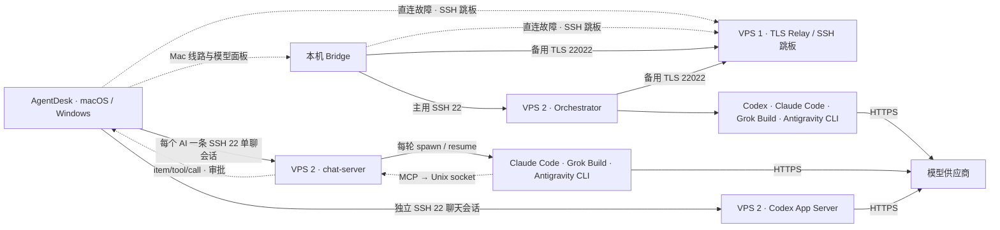

# AgentDesk 双 VPS 架构

AgentDesk 把 AI 主控与本机开发环境分开。VPS 2 运行 Codex、Claude Code、Grok Build 和 Antigravity CLI，并直接连接各模型供应商。Mac 或 Windows 上的 Bridge 提供工作区文件、获准的开发命令和桌面操作。VPS 1 提供备用转发：应用层 TLS Relay（22022）和 SSH 跳板（直连失败时经 VPS1 的受限账号转发到 VPS2:22）。

## 线路与权限

- 主用线路由本机 Bridge 主动连接 VPS 2。专用 SSH 公钥绑定强制命令，只能接入对应的 Unix socket。普通 Codex 聊天使用另一把 SSH 公钥及独立的 App Server 会话；Claude、Grok、Antigravity 的单聊各用一把独立公钥，强制命令只能启动对应 provider 的 chat-server。
- 备用线路由 Bridge 和 VPS 2 分别连接 VPS 1。每一对设备使用不同的令牌，Relay 根据配对注册表转发。TLS 在 Relay 终止，生产部署只将 Relay CA 配置给所需的客户端。
- SSH 跳板与 TLS Relay 相互独立。桌面端、单聊和 Bridge 默认先直连 VPS 2；只有传输层或 DNS 故障才在客户端切换为 `ProxyCommand`，经 VPS 1 的专用 `agentdesk-jump` 账号（`restrict,port-forwarding,permitopen=<VPS2>:22`）用 `-W` 转发到 VPS2:22。外层 SSH 仍端到端认证 VPS 2 并校验它自己的主机指纹；VPS 1 只转发 TCP 字节。目标密钥/known_hosts 与跳板密钥/known_hosts 分离，避免把 VPS 2 的证书交给 VPS 1。跳板认证或主机密钥失败时暂停自动快速重试 10 分钟，防止 VPS 2 的 fail2ban 封禁 VPS 1 的源 IP；`auto` 模式约每 10 分钟用 TCP + SSH banner 探测直连，成功只影响新连接，不迁移或重放已有请求。
- Mac 面板可查看两路状态、手动切换、提交和管理任务。每台设备分别保存线路选择。文件写入和命令执行共享请求 ID 与操作记录，断线后可用在线线路查询结果。
- 设备只授权明确配置的工作区和命令。桌面操作由本机应用提供，受本机桌面开关与操作系统权限约束。模型认证保存在 VPS 2 的服务账户下。

## 单聊流式通道

单聊不经过调度器，也不创建 worktree。Codex 仍走 VPS 2 的 Codex App Server；Claude、Grok、Antigravity 走独立的 `chat-server`：

- `chat-link.js` 在本机为每个 provider 维持一条 SSH 连接（空闲 10 分钟休眠，下次输入自动唤醒），与 Codex 连接互不影响。SSH 强制命令 `agent-chat.sh <provider>` 拉起 `/opt/agentdesk-orchestrator/chat-server.js`。
- 协议是 Codex app-server 的兼容子集（`initialize`、`thread/*`、`turn/*` 及同名通知），所以渲染层复用同一套流式消息、工具卡和审批卡。每个 turn 按需 spawn 一次 Claude、Grok 或 Antigravity CLI，同一线程的后续轮次用 provider 的会话 ID 恢复上下文。
- VPS 上的工作目录只是空的 `chat-workspace/threads/<threadId>`，CLI 自带的文件、命令和联网工具全部禁用。文件能力通过 `chat-mcp.js`（stdio MCP）连到 `chat-<provider>.sock`，每轮使用一次性 capability；chat-server 再以 `item/tool/call` 或 `item/tool/requestApproval` 请求 Electron 主进程。
- MCP 配置的写入位置按 provider 不同：Claude 用 `--mcp-config` 内联，Grok 写工作区的 `.grok/config.toml`（需要 `--trust` 才会加载项目配置），Antigravity 只读用户目录的 `$HOME/.gemini/config/mcp_config.json`。Antigravity 的配置是全局的，chat-server 因此同一时间只运行一个 Antigravity turn，并在每轮结束后只删除自己写入的条目。
- 主进程用 `local-files.js` 在 Mac 上执行 `agentdesk_file_list/read/write/mkdir/copy/move/trash`，写入立即生效。线程在 `thread/start` 时绑定 `projectId` 和 `localRoot`，之后切换活动项目不会改变该会话的文件根目录。
- 权限按轮次的 `approvalPolicy` / `sandboxPolicy` 生效：只读规划只暴露 `list`/`read`，其余模式可弹出审批卡，`never` 直接执行。本机路径仅允许家目录、`/Volumes` 和临时目录，拒绝系统目录、凭据目录；`.git` 可读不可写；写入拒绝符号链接目标，采用临时文件加 `rename` 原子替换。
- 状态保存在 VPS 2 的 `chat-<provider>.json`（0600），只含线程元数据，不含消息正文。App 重启后 Codex 历史仍由 `thread/list` 恢复；Claude/Grok/Antigravity 的 v1 不在 App 侧保留历史列表。

## 任务执行

1. Orchestrator 将任务和关联事件写入 SQLite。任务可使用自动协作，或指定 CLI 与模型 ID。
2. 每个子任务获得独立的 Git Worktree、进程、会话和日志。工作区的当前 Git 提交由本机 Bridge 提供，VPS 2 使用相同提交作为起点。
3. 自动协作时按依赖调度。审核前将补丁留在 VPS 2，检查冲突后由用户选择应用。Bridge 在更新本机文件前核对 Git 基线。
4. 桌面、文件和命令调用可经选定线路发送。大文件按块传输并校验 SHA-256。

## 部署入口

| 组件 | 文档与示例 |
| --- | --- |
| VPS 1 Relay | [运维](../relay/OPERATIONS.md)、[设备注册格式](../relay/devices.example.json)、[传输协议](../relay/PROTOCOL.md) |
| VPS 1 SSH 跳板 | [部署与回滚](DEPLOY.md) §4、[故障排查](TROUBLESHOOTING.md) |
| VPS 2 Orchestrator | [运维](../orchestrator/OPERATIONS.md)、[主控配置](../orchestrator/vps2.example.json)、[业务协议](../orchestrator/PROTOCOL.md) |
| VPS 2 单聊通道 | [chat-server](../orchestrator/chat-server.js)、[chat-mcp](../orchestrator/chat-mcp.js)、[agent-chat.sh](../orchestrator/agent-chat.sh) |
| macOS Bridge 和应用 | [Mac Bridge 配置](../orchestrator/mac-bridge.example.json)、[Mac 客户端 SSH 配置](../config/mac-remote.example.json) |
| Windows Bridge | [Windows Bridge 配置](../orchestrator/windows-bridge.example.json) |

仓库示例使用占位地址和凭据文件路径。每台设备的实际配置、SSH 私钥、TLS 私钥和 API Key 在部署环境管理。
