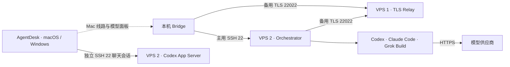

# AgentDesk 双 VPS 架构

AgentDesk 把 AI 主控与本机开发环境分开。VPS 2 运行 Codex、Claude Code 和 Grok Build，并直接连接各模型供应商。Mac 或 Windows 上的 Bridge 提供工作区文件、获准的开发命令和桌面操作。VPS 1 提供备用转发。

## 线路与权限

- 主用线路由本机 Bridge 主动连接 VPS 2。专用 SSH 公钥绑定强制命令，只能接入对应的 Unix socket。普通 Codex 聊天使用另一把 SSH 公钥及独立的 App Server 会话。
- 备用线路由 Bridge 和 VPS 2 分别连接 VPS 1。每一对设备使用不同的令牌，Relay 根据配对注册表转发。TLS 在 Relay 终止，生产部署只将 Relay CA 配置给所需的客户端。
- Mac 面板可查看两路状态、手动切换、提交和管理任务。每台设备分别保存线路选择。文件写入和命令执行共享请求 ID 与操作记录，断线后可用在线线路查询结果。
- 设备只授权明确配置的工作区和命令。桌面操作由本机应用提供，受本机桌面开关与操作系统权限约束。模型认证保存在 VPS 2 的服务账户下。

## 任务执行

1. Orchestrator 将任务和关联事件写入 SQLite。任务可使用自动协作，或指定 CLI 与模型 ID。
2. 每个子任务获得独立的 Git Worktree、进程、会话和日志。工作区的当前 Git 提交由本机 Bridge 提供，VPS 2 使用相同提交作为起点。
3. 自动协作时按依赖调度。审核前将补丁留在 VPS 2，检查冲突后由用户选择应用。Bridge 在更新本机文件前核对 Git 基线。
4. 桌面、文件和命令调用可经选定线路发送。大文件按块传输并校验 SHA-256。

## 部署入口

| 组件 | 文档与示例 |
| --- | --- |
| VPS 1 Relay | [运维](../relay/OPERATIONS.md)、[设备注册格式](../relay/devices.example.json)、[传输协议](../relay/PROTOCOL.md) |
| VPS 2 Orchestrator | [运维](../orchestrator/OPERATIONS.md)、[主控配置](../orchestrator/vps2.example.json)、[业务协议](../orchestrator/PROTOCOL.md) |
| macOS Bridge 和应用 | [Mac Bridge 配置](../orchestrator/mac-bridge.example.json)、[Mac 客户端 SSH 配置](../config/mac-remote.example.json) |
| Windows Bridge | [Windows Bridge 配置](../orchestrator/windows-bridge.example.json) |

仓库示例使用占位地址和凭据文件路径。每台设备的实际配置、SSH 私钥、TLS 私钥和 API Key 在部署环境管理。
